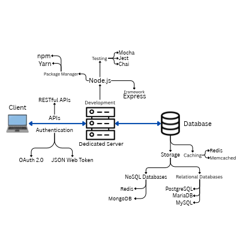

## Back-end Best Practices
Prepared for: future husky student with interest in back-end development
 
Prepared by: Curtis Gilchrist
 
Date: October 27, 2026

<!-- TABLE OF CONTENTS -->

  
Table of Contents

  <ol>
    <li><a href="#purpose">Purpose</a></li>
    <li><a href="#pick-one-framework-and-master-it">Pick one framework and master it</a></li>
    <li><a href="#build-skills-and-your-portfolio-with-projects">Build skills and your portfolio with projects</a></li>
    <li><a href="#electives">Electives</a></li>
  </ol>

<!-- PURPOSE -->
## Purpose
The intention of this document is to inform you on the most effective strategy to land a job in back-end development. This will include what projects you should do that will look promising in a portfolio, what electives to take, etc.
  

<!-- PROJECTS -->
## Pick one framework and master it
A specialist is much more valuable than a generalist, and it's easier too. You don't need to juggle multiple languages and frameworks to get hired. Most companies aren't writing in multiple frameworks at once anyway.
  
Pick your favorite language, whichever you are strongest in, and master its framework. Start by skimming the documentation and then using it in projects of your own. 
  
## Build skills and your portfolio with projects
Having projects outside of your classes shows recruiters that you are capable of teaching yourself, and demonstrates mastery. It also allows you to get practice with tools you will use in industry.
  
Start by finding a problem that can be solved with back-end tools. Simple problems are better to start with, then you can get more complex. Study the problem, study existing solutions. Make your own solution and test with a docker container. Document the whole process, recruiters will want to look at your work.
  

<!-- ELECTIVES -->
## Electives
Consider taking CSS 432 Network Design and Programming. This is because internet architecture is not covered by any of the projects previously listed.
