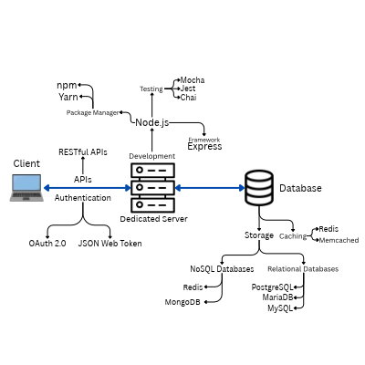

# Back-end Best Practices
Prepared for: Future husky student with interest in back-end development
 
Prepared by: Curtis Gilchrist
 
Date: October 27, 2026

<!-- TABLE OF CONTENTS -->
## Table of Contents
- [Purpose](#purpose)
- [Pick one framework and master it](#pick-one-framework-and-master-it)
- [Build skills and your portfolio with projects](#build-skills-and-your-portfolio-with-projects)
    - [How to pick a project](#how-to-pick-a-project)
    - [Deciding project scope](#deciding-project-scope)
    - [Document your projects](#document-your-projects)
- [Learn network design from electives](#learn-network-design-from-electives)
- [Learn security from GrayHats on-campus](#learn-security-from-grayhats-on-campus)

<!-- PURPOSE -->
## Purpose
The intention of this document is to inform you on the most effective strategy to land a job in back-end development. This will include what projects you should do that will look promising in a portfolio, what electives to take, etc.
  

## Pick one framework and master it
A specialist is much more valuable than a generalist, and it's easier too. You don't need to juggle multiple languages and frameworks to get hired. Most companies aren't writing in multiple frameworks at once anyway.
  
Pick your favorite language, whichever you are strongest in, and master its framework. Start by skimming the documentation and then using it in projects of your own. 
  
## Build skills and your portfolio with projects
Having projects outside of your classes shows recruiters that you are capable of teaching yourself, and demonstrates mastery. It also allows you to get practice with tools you will use in industry.
  

### How to pick a project
Your first projects should be for building fundamentals. Pre-made problems are best for this, because they don't wander out of scope and there are plenty of ways to implement them. There are plenty of resources to find said problems as well[^1], and any issues you run into are likely to be well-documented. This creates an optimal environment to learn.
[^1]: Doglio, F. (2025, December 19). 20 backend project ideas to take you from beginner to pro. roadmap.sh. https://roadmap.sh/backend/project-ideas 

Once you have enough fundamentals, then you can get more complex. At that point, projects are no longer for learning, they are only to be solved. 
  

### Deciding project scope
Most of your projects should not be large-scale. Most of your projects should only focus on just one or two aspects of a server. Focus on learning one thing at a time, and once you have enough pieces you can start to assemble the bigger picture. See image to the right, it would be ridiculous to expect one person to make all moving parts for a back-end as one project. Especially if they are new. This also forces you to build modular code, which is good practice in industry.
  
Determine if your problem can be broken down into smaller components, solve those first. Keep the scope narrow and expand only once you understand the solution.
  

### Document your projects
Recruiters will want to look at your portfolio, having presentable work will signal to them that you are good at communicating and documenting your ideas.
  
Commenting your code is not enough, comments are for fellow programmers. You need to make a `README.md` for every project you do. It should contain a description of the project including what it does, what technologies you used and why, and any additional story info about the project. It should also tell the reader how to install it and how to use it.[^2]
  
[^2]: Nyakundi, H. (2021, December 8). How to write a good README file for your github project. freeCodeCamp.org. https://www.freecodecamp.org/news/how-to-write-a-good-readme-file/ 

<!-- ELECTIVES -->
## Learn network design from electives
Internet architecture is not covered by any of the projects previously listed, but it is an important part of how servers work. Knowledge in that area is valuable no matter what framework you end up using.
  
Take CSS 432 Network Design and Programming, and implement what you learn in more projects.
  

<!-- CLUBS -->
## Learn security from GrayHats on-campus
Websites, being exposed to the open internet, are at constant risk of exploitation. On any given day there could be vulnerability announced about a major web tool, like the PHP2SHELL vulnerabilities that were dropped recently. Security is important to keep the back-end safe.
  
Spend time with GrayHats on campus to learn about these vulnerabilities and how to protect against them. Better yet if you learn to pen-test and make your back-end not just safe from vulnerabilities but secure.
