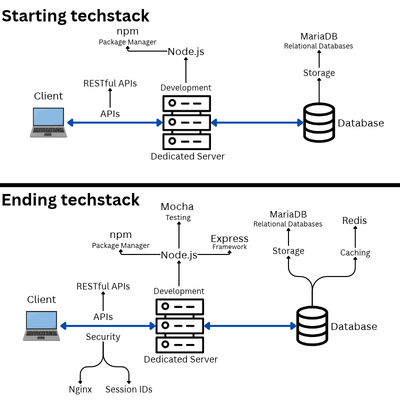

# Best Practices to Become a Back-end Developer
Prepared for: Future husky student pursuing a job in back-end development
 
Prepared by: Curtis Gilchrist
 
Date: November 24, 2026

<!-- TABLE OF CONTENTS -->
## Table of Contents
- [Purpose](#purpose)
- [Pick one framework and master it](#pick-one-framework-and-master-it)
- [Build skills and your portfolio with projects](#build-skills-and-your-portfolio-with-projects)
    - [Picking a project](#picking-a-project)
    - [Deciding project scope](#deciding-project-scope)
    - [Documenting your projects](#documenting-your-projects)
- [Learn network design from electives](#learn-network-design-from-electives)
- [Learn security from GrayHats on-campus](#learn-security-from-grayhats-on-campus)
- [References](#references)

<!-- PURPOSE -->
## Purpose
The intention of this document is to inform you on the most effective strategy to land a job in back-end development. This includes what projects you should do that will look promising in a portfolio, what electives to take, and what extracurriculars to participate in.
  

## Pick one framework and master it
A specialist is much more valuable than a generalist, and it's easier too. You don't need to juggle multiple languages and frameworks to get hired. Most companies aren't writing in multiple frameworks at once anyway.
  
Take the language you are strongest in, and master its framework. If you don't have a strongest language, use JavaScript with the Node.js framework.
  
## Build skills and your portfolio with projects
Having projects outside of your classes shows recruiters that you are capable of teaching yourself, and demonstrates mastery. It also allows you to get practice with tools you will use in industry.
  

### Picking a project
Your first projects are for building fundamentals. Pre-made problems are best for this, because they don't wander out of scope and there are plenty of ways to implement them. There are plenty of resources to find said problems as well[1], and any issues you run into are likely to be well-documented. This creates an optimal environment to learn.

Once you have enough fundamentals, then you need to find more complex problems to solve. Look at a website you use frequently, and try to replicate its functions. 
  

<!-- you can't text wrap and have a caption -->
|  |
|:--:|
| *Expect your stack to expand as you work on projects* |

### Deciding project scope
Most of your projects should not be large-scale. Most of your projects should only focus on just one or two aspects of a server. Focus on learning one thing at a time, and once you have enough pieces you can start to assemble the bigger picture. See the image above, it would be unreasonable to expect one person to make all moving parts for a back-end as one project. Especially if they are new. This also forces you to build modular code, which is good practice in industry.
  
Determine if your problem can be broken down into smaller components, solve those first. Keep the scope narrow and expand only once you understand the solution.
  

### Documenting your projects
Recruiters want to look at your portfolio, having presentable work signals to them that you are good at communicating and documenting your ideas.
  
Commenting your code is not enough, comments are for fellow programmers. You need to make a `README.md` for every project you do. It must contain a description of the project including what it does, what technologies you used and why, and any additional story info about the project. It must also tell the reader how to install it and how to use it.[2]
  

<!-- ELECTIVES -->
## Learn network design from electives
Internet architecture is not covered by any of the projects previously listed, but it is an important part of how servers work. Knowledge in that area is valuable no matter what framework you end up using.
  
Take CSS 432 Network Design and Programming, and implement what you learn in more projects.
  

<!-- CLUBS -->
## Learn security from GrayHats on-campus
Websites, being exposed to the open internet, are at constant risk of exploitation. On any given day there could be vulnerability announced about a major web tool, like the PHP2SHELL and JAVA4SHELL vulnerabilities that were dropped recently. Security is important to keep the back-end safe. Stefan Hoppe, who works at earthsciences.nz as chief information security officer, says "Cybersecurity would be the second largest thing that's going on just because AI is causing a lot of cybersecurity vulnerabilities responses".[3]
  
Spend time with GrayHats on campus to learn about these vulnerabilities and how to protect against them. Learn to pen-test and make your back-end secure. Keep up to date with vulnerabilities, and patch your work when it is affected.

## References
[1]: F. Doglio, "20 backend project ideas to take you from beginner to pro", roadmap.sh. 19 December 2025. [Online]. Available: https://roadmap.sh/backend/project-ideas [Accessed Oct. 27, 2026]

[2]: H. Nyakundi. "How to write a good README file for your github project", freeCodeCamp.org. 8 December 2021. [Online]. Available: https://www.freecodecamp.org/news/how-to-write-a-good-readme-file/ [Accessed Oct. 27, 2026]

[3]: Hoppe, Stefan. Personal Interview. 5 November 2026.

[word count: 630]
